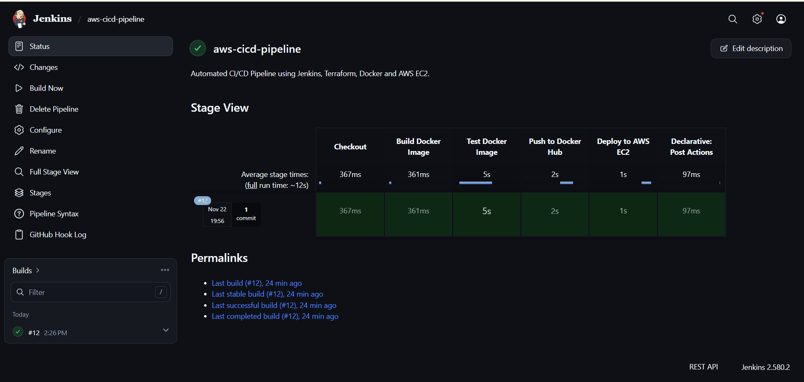
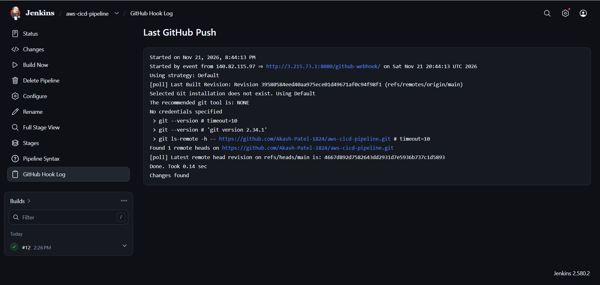
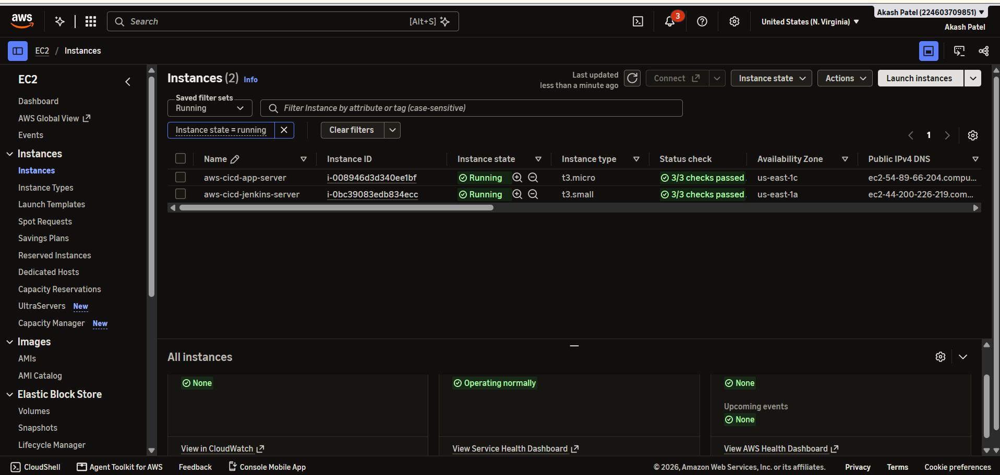
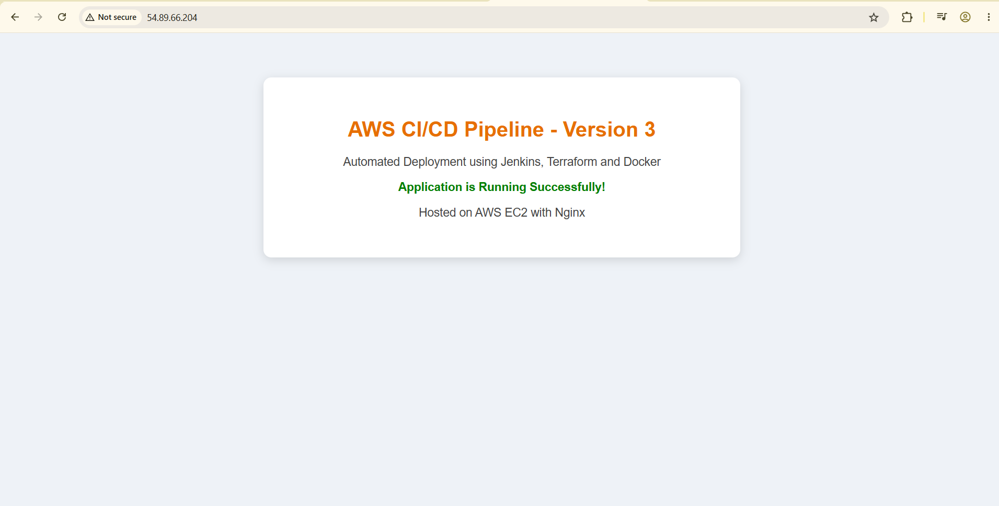

Automated CI/CD Pipeline on AWS using Jenkins, Terraform and Docker

Project Overview

This project demonstrates an automated Continuous Integration and Continuous Deployment (CI/CD) pipeline using Jenkins, Docker, Terraform and AWS EC2.

The application source code is stored in GitHub. Whenever code is pushed to the repository, a GitHub webhook triggers Jenkins to execute the pipeline, build and test a Docker image, push it to Docker Hub, and deploy the application to an AWS EC2 instance.

Technologies Used

- AWS EC2 – Cloud virtual machine for application hosting
- Jenkins – CI/CD automation
- Git and GitHub – Source code management and webhook integration
- Terraform – Infrastructure configuration and AWS resource management
- Docker – Application containerization
- Docker Hub – Docker image registry
- Nginx – Web server for serving the application
- PowerShell – Local command-line operations

Project Architecture

Developer
   |
   v
GitHub Repository
   |
   | GitHub Webhook
   v
Jenkins Pipeline
   |
   v
Checkout Source Code
   |
   v
Build Docker Image
   |
   v
Test Docker Image
   |
   v
Push Image to Docker Hub
   |
   v
Deploy to AWS EC2
   |
   v
Docker Container
   |
   v
Nginx Web Server
   |
   v
Live Web Application

Repository Structure

aws-cicd-pipeline/
|
|-- app/
|   |-- index.html
|
|-- terraform/
|   |-- main.tf
|   |-- .gitignore
|   |-- .terraform.lock.hcl
|
|-- Dockerfile
|-- Jenkinsfile
|-- README.md

CI/CD Pipeline Stages

1. Checkout: Jenkins retrieves the latest source code from GitHub.
2. Build Docker Image: Creates a Docker image using the Dockerfile.
3. Test Docker Image: Runs the Docker image verification stage.
4. Push to Docker Hub: Uploads the image to the Docker Hub repository.
5. Deploy to AWS EC2: Connects to the EC2 instance through SSH, pulls the latest image and runs the application container.
6. Post Actions: Executes pipeline completion actions.

Terraform

Terraform is used to validate and manage the AWS infrastructure configuration.

Commands used:

terraform init
terraform validate
terraform plan
terraform apply

The current Terraform configuration reads the existing AWS VPC, subnet, security group and EC2 instance and provides infrastructure outputs.

Application Deployment

The application is packaged as a Docker image and deployed to AWS EC2.

The application uses Nginx to serve the website.

Deployment status: Successfully deployed and accessible through the EC2 public IP address over HTTP.

Project Results

- GitHub webhook integration verified.
- Jenkins pipeline executed successfully.
- Docker image built and tested.
- Docker image pushed to Docker Hub.
- Application deployed successfully to AWS EC2.
- Nginx serving the application.
- Live application verified in the browser.

Live Application

The deployed application displays:

AWS CI/CD Pipeline - Version 3

Automated Deployment using Jenkins, Terraform and Docker.

Application is Running Successfully!

Hosted on AWS EC2 with Nginx.

Repository

GitHub: https://github.com/Akash-Patel-1824/aws-cicd-pipeline

Learning Outcomes

- CI/CD pipeline automation
- GitHub webhook integration with Jenkins
- Docker image building and deployment
- AWS EC2 deployment using SSH
- Terraform infrastructure configuration
- Automated application delivery 

## Project Screenshots

### 1. Jenkins Pipeline

### 2. GitHub Webhook

### 3. AWS EC2

### 4. Live Application
